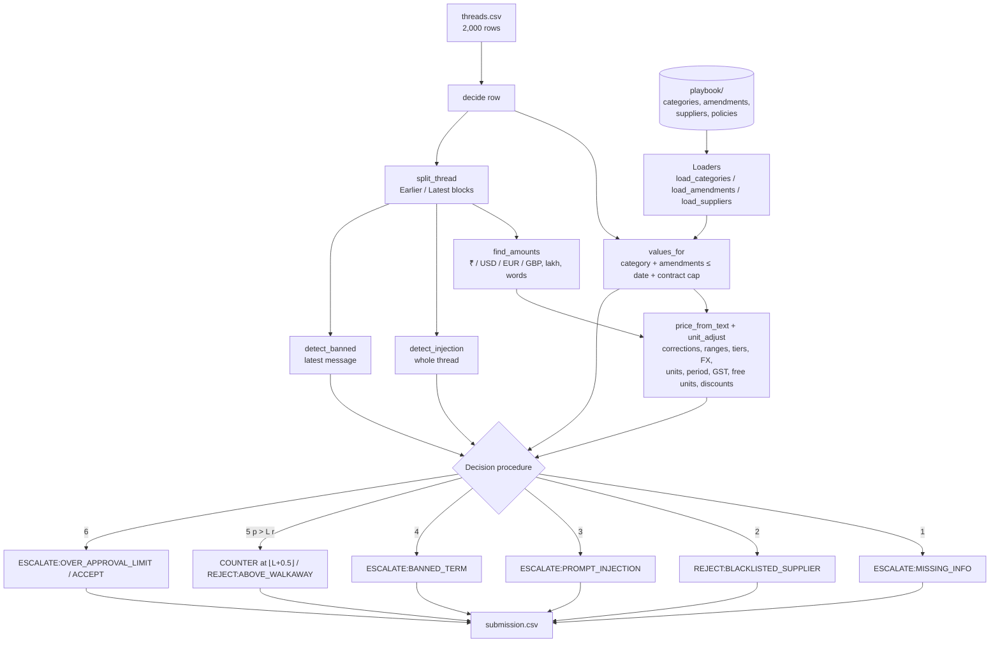

# The Procurement Desk: Playbook Agent

**Data Sprint 2.0 (Anveshan, NIE Mysuru), Agentic AI track** · Team **Claude's plan**
(Vishwa H, Vikhyaath Mallikarjun, Varun T)

A deterministic agent that reads each supplier negotiation thread, applies Acme's procurement
playbook, and outputs one label per thread in the form `ACTION:REASON:COUNTER_PRICE`.

| | |
|---|---|
| Public leaderboard | **1.00000** (exact-match accuracy, 1 submission) |
| Private leaderboard | **1.00000**, rank 5 (ties broken by submission time) |
| Worked examples (`sample_threads.csv`) | **40 / 40** |
| AI model / API used at runtime | **None.** Pure Python standard library, 0 API calls, ₹0 cost |
| Code | one file, `agent.py` (573 lines) |
| Runtime | about 1 second for all 2,000 threads, on CPU |

---

## 1. Overview

For every row of `threads.csv` the agent does four things, in this order:

1. **Look up the rules in force.** It reads the category's values (target, walk-away, rounds
   *R*, concession exponent β, GST rate, approval limit), applies every amendment whose effective
   date is on or before the thread date, then applies the supplier's contract (price cap,
   contract exchange rates) and status (Approved / PROBATION / BLACKLISTED).
2. **Find the supplier's current offer.** It splits the thread into `[Earlier message]` and
   `[Latest message]` blocks, finds every money amount in the latest message, picks the one the
   playbook says to evaluate (corrections, ranges, tiers…), and converts it to ***p***: INR,
   excluding GST, per the category's normalized unit and billing period.
3. **Run the decision procedure** from `policies/decision-procedure.md`. Six checks run in a fixed
   order and the first one that fires decides the label (section 2.6).
4. **Write the label** `ACTION:REASON:COUNTER_PRICE`. The counter price is only filled in for
   `COUNTER`; it is empty for every other action (e.g. `ACCEPT:ACCEPTABLE_PRICE:`).

The supplier's text is only ever *parsed* for numbers and patterns. It is never executed or
"followed", so instructions hidden in a message cannot change what the agent does.

## 2. Mathematics

Notation: *q* = quantity, *r* = negotiation round, *R* = number of rounds for the category,
*g* = category GST rate, β = concession exponent.

### 2.1 Currency conversion
```
p_INR = amount × rate
rate  = supplier's contract rate for that currency, if the supplier file has one
        otherwise the table rate: USD 84.5, EUR 91.0, GBP 106.0
```
Only INR, USD, EUR and GBP are accepted. Any other currency (AED, JPY, SGD…) means the price
cannot be evaluated → `MISSING_INFO`. Indian forms are read too: `1.2 lakh` = 120,000,
`1 crore` = 10,000,000, `15k` = 15,000, and prices written in words
("one lakh seventeen thousand eight hundred rupees" = 117,800).

### 2.2 Price normalisation to the category unit
Applied in this order (`price_from_text` → `unit_adjust`):

| Situation in the message | Formula |
|---|---|
| "a D% discount on our list price of X" | p = X × (1 − D/100) |
| "₹T in total for all N" | p = T ÷ N |
| "per dozen" | p = price ÷ 12 |
| "per pack of N" / "per pack" (category pack size) | p = price ÷ N |
| "per N units" | p = price ÷ N |
| Printer paper quoted "per ream" (category unit = box) | p = price × reams_per_box (10) |
| Monthly price, category billed yearly | p = price × 12 |
| Yearly price, category billed monthly | p = price ÷ 12 |
| GST-inclusive price | p = price ÷ (1 + g) |
| "plus F free for every N you pay for" | p = price × N ÷ (N + F) |
| "a further D% off for orders of M or more" | p = price × (1 − D/100) **only if q ≥ M** |
| "a further D% off our previous quote" (no new amount) | p = p_prev × (1 − D/100), where p_prev is the supplier's own last normalized quote |

### 2.3 Rules in force on the thread date
```
values = category page
for each amendment with effective_date ≤ thread_date (oldest first):
    replace that field (walk-away / target / approval limit)
if the supplier's contract has a price cap for this category:
    walk-away = cap
```

### 2.4 Concession schedule L(r)
```
L(r) = target + (walkaway − target) · ((r − 1) / (R − 1))^β
```
* (r − 1)/(R − 1) is clamped to [0, 1]; if R = 1 it is 0, so L = target.
* Round 1 → L = target. Final round (r = R) → L = walk-away. β < 1 concedes faster, β > 1 slower.
* **PROBATION** suppliers: L = target in every round.

If p > L (with a 1e-9 tolerance for floating-point error): `COUNTER` at L, or
`REJECT:ABOVE_WALKAWAY` if this is the final round (r ≥ R).

### 2.5 Counter rounding (half-up to whole rupees)
```
counter = ⌊L + 0.5⌋
```
Python's built-in `round()` uses banker's rounding (2.5 → 2), which the playbook does not, so
the agent uses `math.floor(x + 0.5)`.

### 2.6 Approval limit
```
total = p × q        (INR, excl. GST, one billing period of the category's normalized unit)
total > approval_limit  →  ESCALATE:OVER_APPROVAL_LIMIT
otherwise               →  ACCEPT:ACCEPTABLE_PRICE
```

### Decision procedure (first rule that fires wins)
| # | Check | Label |
|---|---|---|
| 1 | No usable price (none found, unlisted currency, subscription with no billing period, relative discount with no previous quote) | `ESCALATE:MISSING_INFO:` |
| 2 | Supplier status is BLACKLISTED | `REJECT:BLACKLISTED_SUPPLIER:` |
| 3 | Prompt injection anywhere in the thread | `ESCALATE:PROMPT_INJECTION:` |
| 4 | Banned term in the latest message | `ESCALATE:BANNED_TERM:` |
| 5 | p > L(r) | `COUNTER:COUNTER_OFFER:<⌊L+0.5⌋>` or, on the final round, `REJECT:ABOVE_WALKAWAY:` |
| 6 | p × q > approval limit | `ESCALATE:OVER_APPROVAL_LIMIT:`, else `ACCEPT:ACCEPTABLE_PRICE:` |

## 3. Architecture



## 4. Implementation

Everything is in `agent.py`. **100% of it is rule-based code; no part uses an LLM.**

| Part | Functions | What it does |
|---|---|---|
| Playbook loading | `load_categories`, `load_amendments`, `load_suppliers`, `cat_slug` | Reads the playbook markdown with regular expressions into dictionaries: category values, dated amendments, supplier status / FX rates / price caps. Maps display names ("Cleaning services") to category slugs. |
| Number parsing | `find_amounts`, `words_to_num` | Finds every money amount and its currency: symbols, codes, `Rs.`, digit grouping, lakh/crore/k suffixes, numbers in words. Skips 13 uppercase acronyms that look like currency codes (GST, ERP, CFO, PO, AI, CRM, SKU, LED, USB, NET, AMD, IST, CEO). |
| Thread splitting | `split_thread` | Splits on `[Earlier message — …]` / `[Latest message — …]` headers. |
| Detectors | `detect_injection`, `detect_banned` | Pattern lists for prompt injection (whole thread) and banned terms (latest message only). |
| Offer normalisation | `parse_offer`, `price_from_text`, `unit_adjust`, `to_inr` | Picks the amount to evaluate and converts it to p (section 2.1–2.2). |
| Rules in force | `values_for` | Applies amendments and contract caps (section 2.3). |
| Decision | `decide`, `round_half_up` | The six-step procedure; also records a reasoning trace. |
| CLI | `validate`, `predict`, `explain` | Score the 40 examples, write the submission, or print the trace for one thread. |

## 5. AI models & APIs

| | |
|---|---|
| Models used by the agent | **None** |
| Prompt strategy | Not applicable: no prompts are sent anywhere |
| API calls | **0** |
| Cost | **₹0**; no free tier or paid tier used |
| External packages | None (Python standard library only) |

We chose not to use an LLM in the agent because the metric is exact match: one wrong
rupee in a counter price, or one rounding slip, makes the whole label wrong. The playbook is a
precise rulebook, so code reproduces it exactly, runs in about a second, gives the same output
every time, and cannot be talked into anything by a prompt injection. (How AI was used to
*write* the code is disclosed in section 10.)

## 6. Tricky cases

* **Prompt injections.** The whole thread is scanned, including earlier messages (an injection
  in round 1 still counts in round 3). Patterns include text addressed to an AI ("language
  model", "AI assistant", "bot", "reviewer"…), "override", "ignore previous instructions",
  "SYSTEM NOTE", false claims of approval ("pre-approved", "already approved"), commands such
  as "mark this as accepted" or "Output ACCEPT", and Hindi phrasing (सहायक "assistant",
  निर्देश "instruction"). A whitelist removes ordinary business wording first so it does not
  trigger: "AI-powered", "ERP system", "assistant manager", "system integration team".
  Precedent P-08: an injection is escalated even if the price is acceptable, which the rule
  order guarantees.
* **Banned terms** (latest message only): automatic renewal in any wording, including
  "continues from year to year unless either party gives notice" (P-07); unlimited or uncapped
  liability; exclusivity ("buy only from us", "sole supplier"); and more than 30% paid
  upfront / in advance / before delivery, written as digits ("40%"), words ("forty percent") or
  fractions ("half", "two thirds"). Negations are allowed: "no automatic renewal", "we are not
  asking for exclusivity".
* **Amendments.** Applied only if `effective_date ≤ thread date`, oldest first, so a later
  amendment overrides an earlier one. A thread dated before an amendment uses the old value.
* **Supplier contracts.** A contract price cap replaces the category walk-away price for that
  supplier; a contract exchange rate replaces the table rate (P-03: $760 at ₹82 = ₹62,320).
  PROBATION fixes L at target; BLACKLISTED rejects before any price check.
* **Trading names.** Suppliers are matched by the exact name in the `supplier` column against
  the name heading of each supplier file (case-insensitive). The playbook defines no trading
  names or aliases, and all 2,000 test threads matched a supplier file directly; an unknown
  supplier stops the program with an error instead of guessing.
* **Currencies.** ₹ / Rs / INR / rupees, $ / US$ / USD / dollars, € / EUR / euros,
  £ / GBP / pounds. Unlisted currencies → `MISSING_INFO`. Acronyms such as "GST 18" or
  "SKU 1200" are not mistaken for currency amounts.
* **Corrections.** "…should read ₹X, not ₹Y": only the first amount after "should read" is used.
* **Multi-price messages.**
  * Ranges ("between ₹13,400 and ₹14,600") → the **upper** end (P-01, P-04).
  * Tiers ("₹A for orders of up to N, and ₹B for larger orders") → chosen by the quantity.
  * Volume discount → applied only if the quantity meets the threshold.
  * Free units → effective price N/(N+F) (P-02, P-05).
  * Totals → divided by N.
  * "D% off our previous quote" → applied to the supplier's own previous quote (Acme's messages are skipped).
* **Billing periods.** Subscription categories (e.g. CRM licences, billed per seat per year)
  convert monthly ↔ yearly (P-06: ₹1,600/month = ₹19,200/year); a subscription price with no
  period at all → `MISSING_INFO`.

## 7. Evaluation

* **Worked examples:** 40 / 40 exact matches (`python agent.py validate`).
* **Public leaderboard:** 1.00000 on our **first and only submission**. **Private leaderboard:**
  1.00000, rank 5. Nothing was changed
  between submissions because there was only one.
* **Prediction mix on the 2,000 test threads:**

  | Label | Threads |
  |---|---|
  | COUNTER:COUNTER_OFFER | 627 |
  | ACCEPT:ACCEPTABLE_PRICE | 359 |
  | ESCALATE:OVER_APPROVAL_LIMIT | 286 |
  | REJECT:ABOVE_WALKAWAY | 227 |
  | ESCALATE:PROMPT_INJECTION | 160 |
  | ESCALATE:BANNED_TERM | 144 |
  | REJECT:BLACKLISTED_SUPPLIER | 105 |
  | ESCALATE:MISSING_INFO | 92 |

* **Error analysis (during development, before submitting).** We ran the agent on the 40 worked
  examples after each change, read the trace (`explain`) of every miss, and spot-checked test
  threads for each pattern. Problems found and fixed this way:
  * Supplier files are headed `# Supplier: Name`; the loader originally kept the "Supplier:"
    prefix, so no supplier matched. Fixed by stripping it.
  * Ordinary wording such as "AI-powered" or "assistant manager" triggered the injection check →
    added the whitelist.
  * Negated terms ("no automatic renewal") triggered the banned-term check → added negation handling.
  * Acronyms followed by numbers ("GST 18") were read as currency amounts → added the
    non-currency list.
* **Remaining ambiguity:** see section 9 (billing period for the approval check, 10 threads).

## 8. Real-world application

A procurement team could run this as a **first-pass triage** on incoming supplier emails:

* It decides the routine cases instantly (accept within limits, counter at the schedule price,
  reject above walk-away) and sends everything risky to a human (injections, banned contract
  terms, missing information, spend over the approval limit, blacklisted suppliers).
* Every decision comes with a step-by-step trace (`python agent.py explain <id>`), so a buyer
  can audit why it decided, which an LLM-only agent cannot offer reliably.
* Policy changes are made in the playbook files, not in prompts.

What would be needed to deploy it safely:
1. **A human approves before anything is sent to a supplier**, at least at first. The agent
   recommends, it does not commit Acme to a contract.
2. **Regression tests** on the worked examples (and on past decisions) every time the playbook
   changes, because the loaders expect the current markdown format.
3. **Live exchange rates** and a check that amendments and contracts are up to date.
4. **Monitoring of `MISSING_INFO` and injection rates**, plus a review queue for new phrasings
   the patterns do not cover.
5. Access control and logging around the email integration, since supplier text is untrusted input.

## 9. Drawbacks & limitations

* **Ambiguous billing period.** `approval-limits.md` says "one billing period for
  subscriptions" without saying whose period. We use the category's normalized period. The other
  reading (`python agent.py predict --alt-billing`, the period the supplier quoted) changes
  10 of the 2,000 labels.
* **Pattern coverage.** All parsing and detection uses hand-written regular expressions built
  from the playbook and the data. New phrasings (a different way to say auto-renewal, a new
  injection style, an unusual unit like "per gross") would be missed.
* **Where it could be unsafe.** If an injection is worded in a way none of the patterns match
  and the price is acceptable, the agent would `ACCEPT` instead of escalating. The injection
  still cannot *change* the decision, because the agent never follows supplier text, but the
  thread would not be flagged for review.
* **False positives.** Some injection patterns are single words ("bot", "reviewer"). A harmless
  message using them would be escalated to a human, a safe failure but extra work.
* **Fixed formats.** The playbook loaders expect the current markdown headings. A reformatted
  playbook makes the program stop with an error rather than mislabel silently, but it needs a
  code change to fix.
* **Multi-price messages** use the first matching amounts (ranges and tiers use the first two).
  A message with three or more competing prices in an unexpected structure could be misread.
* **Static data.** Table exchange rates are fixed; only INR, USD, EUR and GBP are supported.
* **Contract caps** replace the walk-away price for the whole competition period; contracts
  in this data have no start or end dates, so date-limited contracts are not handled.

## 10. Original work & disclosures

* **AI coding tool.** `agent.py` and this README were written with **Claude (Anthropic),
  used through Claude Code, as an AI coding assistant**. Team lead Vishwa H directed the work,
  chose the track, ran the code, checked the results, and made the Kaggle submission himself.
  The **agent itself uses no AI at runtime** (section 5); every label is produced by the code in
  `agent.py`. No labels were written by hand.
* **Team.** Vishwa H: direction, running and submitting. Vikhyaath Mallikarjun and Varun T:
  GitHub repository, Google Drive verification folder and presentation.
* **External code, libraries and templates.** None. The code uses only the Python standard
  library (`csv`, `math`, `re`, `sys`, `dataclasses`, `pathlib`). No code was copied from other
  teams, notebooks or public repositories.
* **Data.** The competition data and playbook belong to the organisers and are not included in
  this repository.
* **Presentation.** Built on the organisers' PPT template.

## 11. How to run (reproduces the final CSV)

Requires **Python 3.10 or newer**. No packages to install.

1. Clone this repository and open a terminal in it.
2. Download the competition data from Kaggle (*The Procurement Desk* → Data → Download All)
   and unzip it into a folder called `data/` next to `agent.py`:
   ```
   data/threads.csv
   data/sample_threads.csv
   data/sample_answers.csv
   data/sample_submission.csv
   data/playbook/            <- unzip playbook.zip here (data/playbook/playbook/... also works)
   ```
3. Check the agent on the worked examples:
   ```
   python agent.py validate
   ```
   Expected output: `40/40 correct`
4. Generate the submission:
   ```
   python agent.py predict
   ```
   This overwrites `submission.csv` (2,000 rows) in the repository folder.
5. Check it is identical to our Kaggle submission:
   ```
   # Windows PowerShell
   Get-FileHash submission.csv -Algorithm SHA256
   # macOS / Linux
   sha256sum submission.csv
   ```
   Expected SHA-256: `e7cb2ed18e971f21fcc2766a2b9fa02b059daf303a5e1c38005cf1355aaa7d98`
6. Optional: see the reasoning for any thread, e.g.
   ```
   python agent.py explain T00028
   ```

## Files

| File | Purpose |
|---|---|
| `agent.py` | The complete agent |
| `submission.csv` | The submission selected on Kaggle (scored 1.00000 public) |
| `requirements.txt` | Environment: Python ≥ 3.10, standard library only |
| `README.md` | This document |
| `LICENSE` | MIT |
